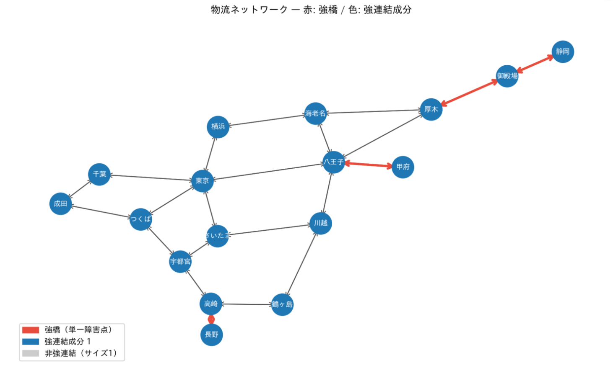
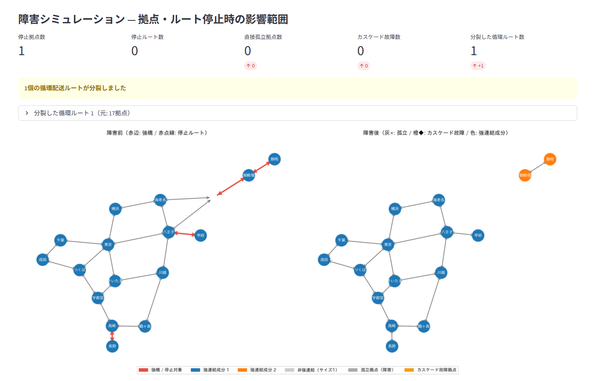

# 物流ネットワーク障害シミュレーター

物流・交通・通信ネットワークを有向グラフとして扱い、**「どのルートが1本止まるだけで循環が崩れるか」（強橋）**を事前に特定するWebアプリです。拠点やルートが停止したときの**直接の孤立・連鎖的な補給途絶（カスケード故障）・迂回コストの増加**もシミュレーションし、可視化します。

グラフ理論のアルゴリズム（支配木を用いた強橋検出、多始点BFS）を実装し、素朴な実装と結果が一致することを408件のテストで検証しています。






## デモ：関東17拠点の物流ネットワーク

実在の地名と道路距離（km）をもとにしたネットワークで、3つのシナリオを用意しています。サイドバーから1クリックで読み込めます。

| シナリオ | 分析内容 | 結果 |
|---|---|---|
| 1. 末端依存の強橋 | 単一障害点となるルートの特定 | 44本中8本が強橋。長野・甲府・静岡は1本のルートでしかつながっていない |
| 2. 中継拠点の停止 | 御殿場が停止した場合の影響 | 静岡が完全に孤立し、循環配送のまとまりが1つ分裂する |
| 3. 幹線の遮断 | 東京↔横浜の直通ルートが両方向とも止まった場合 | 迂回路は東京→八王子→海老名→横浜となり、距離が30km→85km（約2.8倍）に増える |

各シナリオの結果は、テスト（`tests/test_algorithms.py`）でも確認しています。

## 主な機能

| 機能 | 内容 |
|---|---|
| **強橋（単一障害点）の検出** | 除去すると強連結成分が分裂するルートを特定し、赤で表示します。 |
| **障害シミュレーション** | 停止させる拠点・ルートを選ぶと、孤立した拠点を「完全孤立」「補給不能（入ってくるルートなし）」「配送不能（出ていくルートなし）」に分類し、さらにカスケード故障と分裂した強連結成分を表示します。 |
| **迂回コストの分析** | 停止したルートの両端について、障害前後の最短経路コストを比較します。 |
| **ネットワークの入力** | デモシナリオ、テキスト入力、ランダム生成（シード固定で再現可能）、CSVアップロードに対応しています。 |
| **規模に応じた描画** | 80拠点まではMatplotlibの静止画、200拠点まではPyVisのインタラクティブ表示に自動で切り替えます。 |

## アルゴリズム

### 強橋の検出

**定義**：有向グラフで、除去すると強連結成分の数が増える辺を**強橋**と呼びます。物流では「この1本が止まると、互いに行き来できていた拠点群が分断される」ルートにあたります。

**素朴な方法**：強連結成分の内部にある辺 (u, v) について、「(u, v) が強橋であること」と「(u, v) を除いたあとに u から v へ到達できないこと」は同値です。そこで、辺を1本ずつ除いて到達可能性を調べれば強橋が分かります。ただし計算量は O(E × (V + E)) です。

**本実装の方法**（Italiano, Laura, Santaroni 2012 の考え方）：強連結成分から任意の頂点 r を選ぶと、次が成り立ちます。

> 強橋の集合 ＝（r を始点とするフローグラフの橋）∪（逆向きのグラフで r を始点としたときの橋）

ここで、フローグラフの**橋**とは、r から到達するのに必ず通る辺のことです。各辺の中点に補助ノード x を挟んだグラフで支配木を求めると、「辺 (u, v) が橋」⇔「x が v の直接支配節点」となるため、強連結成分ごとに支配木を2回計算するだけで強橋がすべて求まります。

支配木を Lengauer–Tarjan 法で求めれば、全体で線形時間になることが知られています。本実装では NetworkX の `immediate_dominators`（Cooper–Harvey–Kennedy 法）を使っています。

### カスケード故障の検出

**定義**：直接孤立していない拠点 v のうち、v に到達できる拠点（祖先）がすべて直接孤立した拠点であるもの。入次数だけを見ていると、「荷物は届くルートがあるが、その上流がすべて止まっている」拠点を見逃します。

> 例：X → A → B → C で X が停止すると、A は入ってくるルートがなくなり直接孤立します。B には A からのルートが残っていますが、A が補給を受けられないため、B も実質的に補給不能になります。

**方法**：定義どおりに拠点ごとに祖先を調べると O(V × (V + E)) かかります。本実装では発想を逆にして、「健全な拠点から到達できる拠点」を多始点BFSで一度に求め、そこに含まれない拠点をカスケード故障とします。計算量は **O(V + E)** です。

### 迂回コストの分析

停止したルートの両端について、障害前後のグラフでダイクストラ法により最短経路コストを求めて比較します。計算量は停止したルート1本あたり O(E + V log V) です。

## 正しさの検証

高速な実装が正しいことを、定義どおりの素朴な実装と比較して確認しています。

| テスト | 内容 |
|---|---|
| 強橋の検出 | ランダムな有向グラフ200個（自己ループを含む）で、素朴な方法と結果が完全に一致すること |
| カスケード故障の検出 | ランダムな有向グラフと停止拠点の組200個で、定義どおりの実装と結果が完全に一致すること |
| デモシナリオ | 3つのシナリオの説明文に書かれた結果（強橋8本、静岡の孤立、30km→85km）が実際に得られること |
| 入力の保護 | 分析によって入力グラフ（辺の重みを含む）が変更されないこと |

```bash
python -m pytest
```

## 性能

強橋検出の実行時間を、素朴な方法と比較しました（`benchmarks/benchmark_strong_bridges.py`）。

**ランダムな有向グラフ**

| 拠点数 V | ルート数 E | 強橋の数 | 素朴な方法 | 支配木を用いる方法 | 比 |
|---:|---:|---:|---:|---:|---:|
| 1,000 | 2,969 | 272 | 0.16 秒 | 0.13 秒 | 1.2倍 |
| 2,000 | 6,045 | 479 | 0.47 秒 | 0.33 秒 | 1.4倍 |
| 4,000 | 12,152 | 1,000 | 1.14 秒 | 0.84 秒 | 1.4倍 |
| 8,000 | 24,072 | 2,056 | 3.24 秒 | 2.06 秒 | 1.6倍 |

**幹線でつながる地域網**（5拠点の地域を1本の幹線で直列につないだもの）

| 拠点数 V | ルート数 E | 強橋の数 | 素朴な方法 | 支配木を用いる方法 | 比 |
|---:|---:|---:|---:|---:|---:|
| 1,000 | 2,398 | 398 | 0.17 秒 | 0.12 秒 | 1.4倍 |
| 2,000 | 4,798 | 798 | 0.87 秒 | 0.34 秒 | 2.5倍 |
| 4,000 | 9,598 | 1,598 | 3.81 秒 | 0.59 秒 | 6.4倍 |
| 8,000 | 19,198 | 3,198 | 17.52 秒 | 1.55 秒 | 11.3倍 |

ランダムなグラフでは差は小さく、どちらも実用的な速さです。これは、強橋でない辺を除いた場合、到達判定がすぐに迂回路を見つけて終わるためです。

一方、幹線の両側に大きな領域がある構造では、素朴な方法は強橋ごとにグラフ全体を探索することになり、拠点数が2倍になると実行時間が約4〜5倍に増えます（2乗に比例）。支配木を用いる方法はほぼ拠点数に比例して増えるだけなので、8,000拠点で約11倍の差がつきました。

測定環境：Linux（x86_64）、Python 3.13、NetworkX 3.6。実行時間は環境によって異なります。

## 構成

```
.
├── main.py                 # Streamlitアプリ本体（画面の構築と各モジュールの統合）
├── algorithms.py           # グラフアルゴリズム（Streamlitに依存しない純粋なロジック）
├── visualization.py        # 描画（Matplotlib / PyVis）と日本語フォントの設定
├── scenarios.py            # デモシナリオの定義、グラフの構築、CSVの読み込み
├── tests/
│   └── test_algorithms.py  # 素朴な実装との比較、デモシナリオの検証
└── benchmarks/
    └── benchmark_strong_bridges.py  # 強橋検出の実行時間の比較
```

アルゴリズムを `algorithms.py` に分離し、画面（Streamlit）に依存しない形にしているため、アプリを起動せずにテストやベンチマークを実行できます。

## 使い方

Python 3.10 以上が必要です。

```bash
pip install -r requirements.txt
streamlit run main.py                          # アプリの起動（ブラウザが開きます）
python -m pytest                               # テストの実行
python -m benchmarks.benchmark_strong_bridges  # ベンチマークの実行
```

**CSVの形式**：`from`、`to` 列が必須で、`cost` 列は任意です（迂回コストの計算に使います。省略した場合は1）。

```csv
from,to,cost
東京,横浜,30
横浜,東京,30
```

## 今後の課題

- **拠点の単一障害点（強関節点）の検出**：現在はルート（辺）の単一障害点のみを扱っています。強関節点も同じく支配木から線形時間で求められることが知られています。
- **強橋をなくすための補強計画**：「どこに何本ルートを追加すれば強橋がなくなるか」を求める問題（連結度の増強問題）に取り組み、冗長化の提案まで行えるようにしたいと考えています。
- **輸送容量の考慮**：現在は「つながっているか」と「最短距離」のみを見ています。最大流を用いて、迂回路で運びきれる量まで評価できるようにしたいです。
- **支配木計算の高速化**：Lengauer–Tarjan 法を実装し、最悪の場合でも線形時間となることを保証する。

## 参考文献

- G. F. Italiano, L. Laura, F. Santaroni. Finding strong bridges and strong articulation points in linear time. *Theoretical Computer Science*, 447:74–84, 2012.
- T. Lengauer, R. E. Tarjan. A fast algorithm for finding dominators in a flowgraph. *ACM Transactions on Programming Languages and Systems*, 1(1):121–141, 1979.
- K. D. Cooper, T. J. Harvey, K. Kennedy. A simple, fast dominance algorithm. *Software Practice & Experience*, 4:1–10, 2001.
